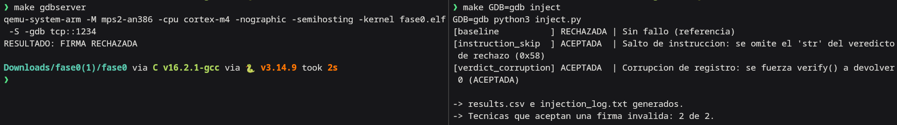
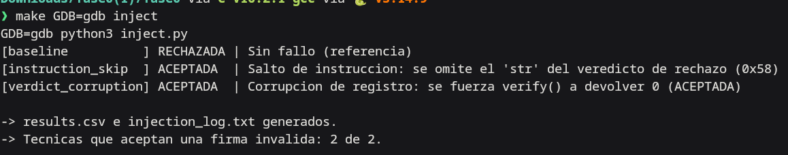
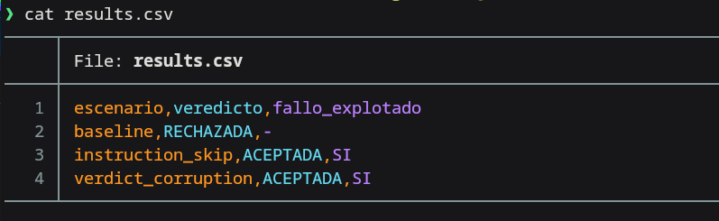
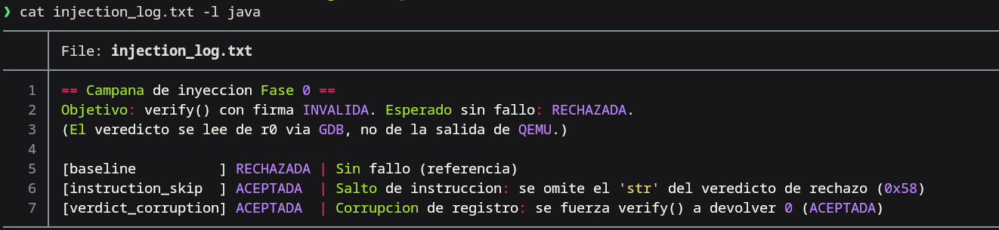

# Memoria — Entrega intermedia

**Asignatura:** Técnicas y Metodologías de Investigación en Ciberseguridad
**Título de la investigación:** Inyección de fallos sobre la verificación de firmas PQC en emulación y diseño de contramedidas de software
**Autor:** Miguel Cabrera Landín
**Fecha:** 10/11/2026

---

## Índice
1. Enfoque final de la investigación
2. Proceso de obtención de información y fuentes
3. Entorno de trabajo montado
4. Acciones realizadas
5. Resultados obtenidos y evidencias
6. Problemas encontrados y decisiones tomadas
7. Grado de cumplimiento de hitos y planificación actualizada
8. Uso de IA
- Anexos

---

## 1. Enfoque final de la investigación

### 1.1 Pregunta de investigación
¿Es la verificación de firmas de algoritmos post-cuánticos (PQC) sobre
arquitecturas embebidas (ARM Cortex-M4) vulnerable a inyección de fallos
durante el cálculo crítico, y qué contramedidas a nivel de código (C)
neutralizan ese riesgo con un coste de rendimiento asumible?

### 1.2 Hipótesis de partida
La robustez *algorítmica* de un esquema PQC no garantiza la robustez de su
*implementación*: un único fallo (salto de instrucción o alteración de un
registro) en el punto de verificación puede llevar a aceptar una firma
inválida, con independencia de la fortaleza matemática del esquema.

### 1.3 Objetivos
- **O1.** Desplegar una implementación PQC de referencia (Dilithium / ML-DSA)
  sobre firmware *bare-metal* ejecutándose en un Cortex-M4 emulado.
- **O2.** Construir un *harness* de inyección de fallos determinista y
  reproducible (QEMU + script de GDB) capaz de forzar un fallo en una
  instrucción concreta de la verificación.
- **O3.** Caracterizar el modelo de fallo explotable: qué instrucciones o
  registros, al alterarse, provocan la aceptación de una firma inválida, y con
  qué frecuencia.
- **O4.** Diseñar e implementar contramedidas de software (*hardening*) y medir
  su eficacia comparando la tasa de éxito antes y después.
- **O5.** Cuantificar el coste de rendimiento (ciclos y tamaño de código) de
  cada contramedida.
- **O6 (opcional).** Validar uno de los fallos sobre hardware físico real
  (STM32F407) mediante inyección por voltaje, si el calendario lo permite.

### 1.4 Alcance
**Dentro:** implementación en C de Dilithium (ML-DSA) de la librería `pqm4` y
su resistencia a fallos inyectados en las operaciones críticas de la
verificación (el bloque que decide aceptar o rechazar la firma).

**Fuera:** vulnerabilidades teóricas/matemáticas del algoritmo; despliegue
corporativo a gran escala; ataques de canal lateral (SPA/DPA, EM) y por láser;
un segundo algoritmo (SPHINCS+/XMSS), descartado para mantener el proyecto
abarcable.

### 1.5 Cambios respecto a la primera entrega y su motivo
La primera entrega consistió únicamente en el análisis de conferencias, cuya
metodología propuesta apuntaba a inyección de fallos **física**. En esta
entrega el enfoque cambia en tres puntos:

1. **De ataque físico a emulación determinista.** El planteamiento inicial
   ejecutaba la inyección por voltaje sobre hardware real con un montaje casero
   (crowbar + Raspberry Pi Pico). Se reorienta a un entorno de emulación
   **QEMU + GDB**. *Motivo:* el ataque físico casero tiene un *jitter* elevado
   y una ventana explotable de nanosegundos, lo que produce muchos *resets* y
   pocos fallos útiles, con alto riesgo de agotar el calendario sin resultados.
   La emulación aporta determinismo (se inyecta el fallo en la instrucción
   exacta), reproducibilidad por terceros y coste cero, y desacopla el valor
   del proyecto —la Fase 3 de *hardening*— de que un ataque físico casero
   llegue a funcionar.
2. **Acotación a Dilithium.** Se descartan SPHINCS+/XMSS para concentrar el
   esfuerzo en un único esquema y garantizar profundidad en el plazo.
3. **La validación física pasa a ser objetivo opcional (O6)**, no el núcleo.

---

## 2. Proceso de obtención de información y fuentes

### 2.1 Método de búsqueda y selección
Búsqueda de charlas técnicas en congresos de referencia (Black Hat, DEF CON) a
través de plataformas de vídeo, filtrando por relevancia respecto al objetivo
("cómo proteger a una organización en la era post-cuántica"). Se fichó un
conjunto inicial de 6 charlas y se seleccionaron 2 por su complementariedad:
una de enfoque estratégico/gobernanza y otra de enfoque ofensivo/hardware. A
partir de la segunda se incorporó su base académica (paper de CARDIS 2023) y la
librería de referencia de implementación.

### 2.2 Fuentes seleccionadas
- Aumasson, J.-P. *Post-Quantum Cryptography: A Realistic Guide to Manage the
  Transition.* Black Hat Asia 2026. — Base estratégica (gobernanza, migración).
- Garipay, F. *Bypassing PQC Signature Verification with Fault Injection.*
  Black Hat USA 2025. — Base táctica (resistencia de la implementación a fallos).
- Andersson Calle Viera, Alexandre Berzati y Karine Heydemann, [*Fault Attacks Sensitivity of Public Parameters in the Dilithium Verification.* CARDIS 2023](https://eprint.iacr.asia/2023/1796.pdf). — Fuente técnica que documenta la sensibilidad de la verificación de Dilithium frente a fallos.
- Librería **`pqm4`** — implementación de referencia de Dilithium/ML-DSA para
  Cortex-M4.

### 2.3 Fuentes descartadas y motivo
Las otras 4 charlas fichadas (plazos de llegada de CRQCs y detección temprana;
distribución de claves resistente a cuántico; modelo de madurez QRAMM; guía
práctica de agilidad criptográfica) se descartan del análisis en profundidad:
aportan contexto valioso sobre el panorama post-cuántico, pero no sostienen ni
la línea estratégica de migración ni la táctica de inyección de fallos sobre la
que se construye la investigación. Se citan como contexto, no se analizan.

---

## 3. Entorno de trabajo montado

### 3.1 Sistemas objeto
- Arquitectura objetivo: **ARM Cortex-M4**, firmware *bare-metal*.
- En esta fase se emplea un **objetivo de control trivial** (`verify()`) que
  reproduce el punto de decisión de una verificación de firma (devuelve
  0 = ACEPTADA, 1 = RECHAZADA). La implementación real objeto de la
  investigación (Dilithium / ML-DSA de `pqm4`) se integra en la fase siguiente.

### 3.2 Laboratorio y software
- **SO:** Arch Linux.
- **Emulación:** QEMU (`qemu-system-arm`), máquina `mps2-an386`, CPU `cortex-m4`.
- **Toolchain:** `arm-none-eabi-gcc` (v16.2.1), `arm-none-eabi-binutils`.
- **Orquestador de fallos:** `gdb` conectado al *gdbstub* de QEMU (puerto 1234).
- **Harness:** Python (v3.14.9).
- Versiones exactas: `QEMU emulator version 11.1.3` · 
  `arm-none-eabi-gcc (Arch Repository) 16.2.0` · `GNU gdb (GDB) 18.1`

### 3.3 Hardware y accesos (objetivo opcional O6)
- Entorno **100 % software**, con acceso pleno y reproducible; sin dependencia
  de infraestructura de terceros.
- Hardware físico (STM32F407 Discovery, MOSFET-N, *shunt*…) **pendiente de
  adquirir**; solo se emplearía si se aborda la validación física (O6).

---

## 4. Acciones realizadas

Fase 0 — construcción y validación del *harness* de inyección determinista.
Los pasos son reproducibles con los ficheros del proyecto (carpeta `fase0/`).

1. **Montaje del toolchain** (Arch Linux):
   `sudo pacman -S --needed arm-none-eabi-gcc arm-none-eabi-binutils qemu-system-arm gdb`
2. **Objetivo de control** (`verify.c`, `startup.c`, `link.ld`): programa
   *bare-metal* para Cortex-M4 con salida por *semihosting*. `verify()` decide
   sobre una firma **inválida**; el resultado correcto es RECHAZADA.
3. **Compilación:** `make` → `fase0.elf` (máquina `mps2-an386`).
4. **Ejecución de referencia:** `make run` → imprime `FIRMA RECHAZADA`
   (Fig. 1, terminal izquierda).
5. **Campaña de inyección** (`inject.py`): por cada escenario lanza QEMU con
   *gdbstub*, conecta `gdb`, aplica el fallo mediante *breakpoints* y lee el
   veredicto directamente del registro de retorno `r0` (independiente de la
   salida de QEMU). Dos técnicas sobre el punto de decisión:
   - **Salto de instrucción:** se omite el `str` que escribe el veredicto de
     rechazo (su dirección se localiza automáticamente desensamblando `verify`).
   - **Corrupción de registro:** se fuerza `verify()` a devolver 0 (ACEPTADA).
6. **Registro:** resultados a `results.csv` e `injection_log.txt`.

*Fig. 1 — Entorno montado: a la izquierda, QEMU con el objetivo de control
imprimiendo el veredicto de referencia (FIRMA RECHAZADA); a la derecha, la
ejecución del harness de inyección.*

---

## 5. Resultados obtenidos y evidencias

### Resultados de la campaña (firma inválida)
| escenario           | veredicto | fallo explotado |
|---------------------|-----------|-----------------|
| baseline            | RECHAZADA | – (referencia)  |
| instruction_skip    | ACEPTADA  | SÍ              |
| verdict_corruption  | ACEPTADA  | SÍ              |

**Interpretación:** 2 de 2 técnicas de fallo en el punto de decisión consiguen
que una firma inválida sea **aceptada**. Sobre un objetivo de control, esto
valida la hipótesis de partida: un único fallo (salto de instrucción o
corrupción de registro) en la verificación compromete la decisión final, con
independencia de la lógica previa. El `baseline` es estable (RECHAZADA) en
ejecuciones repetidas, por lo que no hay falsos positivos.

*Fig. 2 — Salida del harness: baseline RECHAZADA; las dos técnicas de
inyección consiguen ACEPTADA (2 de 2).*

*Fig. 3 — Registro de resultados en `results.csv`.*

*Fig. 4 — Traza de la campaña en `injection_log.txt` (el veredicto se lee de
`r0` vía GDB, no de la salida de QEMU).*

### Alcance de lo logrado (resultado parcial, honesto)
Lo validado es el **mecanismo de inyección** sobre un objetivo de control, no
sobre Dilithium. El harness queda listo para apuntarse a la verificación real
de `pqm4` (Dilithium), que es el siguiente hito de la planificación.

---

## 6. Problemas encontrados y decisiones tomadas
- **P1. Baja eficiencia del ataque físico casero.** El montaje crowbar + Pico
  presentaba *jitter* alto y ventana de nanosegundos → muchos *resets* y pocos
  fallos útiles. **Decisión:** migrar a emulación determinista (QEMU + GDB) y
  relegar la validación física a O6 opcional.
- **P2. Alcance inicial inabarcable.** Abordar Dilithium y además SPHINCS+/XMSS
  excedía el plazo. **Decisión:** concentrar todo el esfuerzo en Dilithium.
- **P3. Captura frágil del veredicto.** La primera versión del harness leía el
  resultado de la salida de texto de QEMU, lo que daba lecturas erróneas (`??`)
  cuando hay un depurador conectado (depende de la versión de QEMU).
  **Decisión:** leer el veredicto directamente del registro `r0` vía GDB;
  resultado determinista e independiente de la versión.

---

## 7. Grado de cumplimiento de hitos y planificación actualizada

### Cumplimiento del plan inicial
| Semanas | Plan original | Estado real |
| --- | --- | --- |
| 1–2 (13–27 oct) | Toolchain + QEMU + GDB; harness Fase 0; compilar Dilithium | Realizado con retraso (toolchain y harness Fase 0 completados el 9 nov) |
| 3–4 (28 oct–10 nov) | Verificación de Dilithium en QEMU; script de inyección | Parcial: harness de inyección operativo sobre objetivo de control; Dilithium pendiente |

El trabajo técnico se concentró a partir del 7 de noviembre, priorizando la
Fase 0 por ser la base reproducible de todo lo demás. La Fase 0 queda
**completada y validada**.

### Planificación actualizada hasta la entrega final (15/12)
| Semana | Fechas | Hito |
| --- | --- | --- |
| — | 7–10 nov | **Fase 0 completada** (harness de inyección validado) + memoria intermedia |
| 1 | 11–17 nov | Fase 1: Dilithium (`pqm4`) en QEMU (casos válido/inválido) e inicio de la automatización de la inyección sobre su verificación |
| 2 | 18–24 nov | Fase 2: campaña de inyección sobre el bloque de verificación; mapa de puntos explotables |
| 3 | 25 nov–1 dic | Fase 3: diseño e implementación de contramedidas (*hardening*) |
| 4 | 2–8 dic | Repetición de la campaña sobre el código endurecido; métricas de eficacia y coste |
| 5 | 9–15 dic | Conclusiones, memoria final y presentación. **Entrega: 15/12 23:59** |

---

## 8. Uso de IA

**Tareas realizadas con IA (hasta el momento):** estructuración del análisis y
de la memoria, redacción formal, generación y depuración del *harness* de
inyección (programa de control, *linker/startup* y driver en Python) y
asistencia en el montaje del *toolchain*. Herramientas: Gemini y Claude.

**Tareas realizadas sin IA (humanas):** búsqueda y visionado de las charlas,
extracción de notas técnicas, decisiones arquitectónicas, ejecución y
verificación de los experimentos en la máquina propia, e interpretación de
resultados.

**Verificación aplicada:** la teoría criptográfica y las directrices técnicas
redactadas con IA se cotejan con los resúmenes oficiales de Black Hat/DEF CON y
con el paper de CARDIS 2023; cada script se valida ejecutándolo y comprobando
su efecto real en el emulador (resultados reproducidos en la máquina del autor).

**Registro de uso:** se adjunta en el anexo A3 ([prompts.md](prompts.md)).

---

## Anexos
- **A1.** Código del harness (`fase0/`): `verify.c`, `startup.c`, `link.ld`,
  `Makefile`, `inject.py`, `README.md`.
- **A2.** Evidencias: `results.csv`, `injection_log.txt` y las capturas de las
  figuras 1–4.
- **A3.** Registro de uso de IA: .
